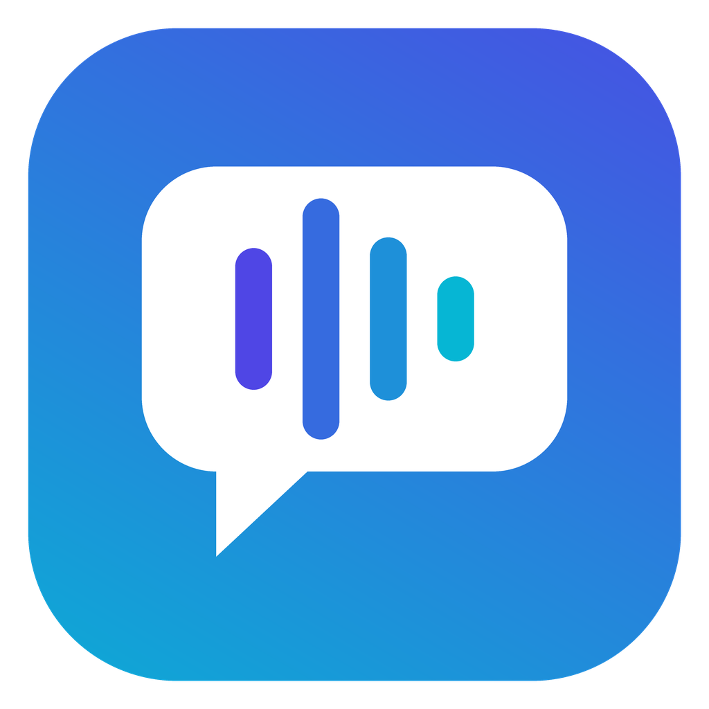
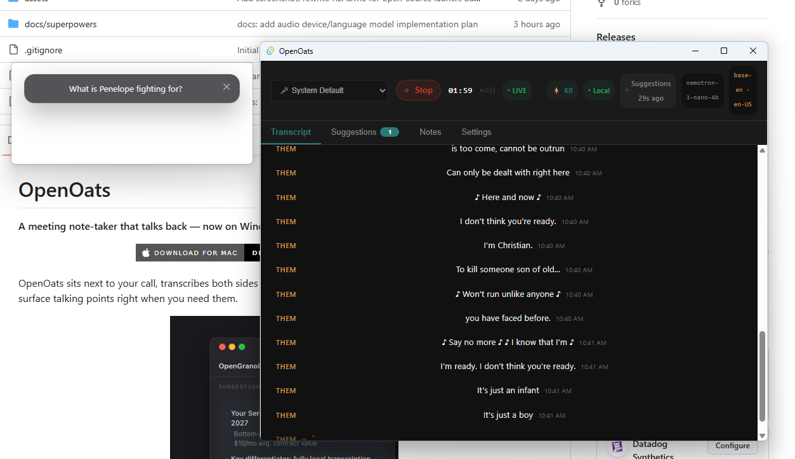

# ContextCall

<p align="center">
  
</p>

**A local-first desktop meeting assistant for Windows, macOS and Linux.**

> **Acknowledgement:** ContextCall builds on groundwork from [OpenOats](https://github.com/yazinsai/OpenOats) by [yazinsai](https://github.com/yazinsai) and its successor OpenCassava. It is now a standalone project with its own roadmap, focused on cross-platform support and live-call intelligence.

<p align="center">
  <a href="https://github.com/romeroej2/ContextCall/releases/latest">
    
  </a>
  &nbsp;
  <a href="https://github.com/romeroej2/ContextCall/releases/latest">
    
  </a>
  &nbsp;
  <a href="https://github.com/romeroej2/ContextCall/releases/latest">
    
  </a>
</p>

ContextCall transcribes both speakers in a call in real time. It grounds its suggestions in your own notes and documents, so what it shows comes from material you wrote. Privacy comes first. With LM Studio or Ollama, the models run on your computer, and your audio, transcripts and notes stay there.

- **Local models.** Language models and embeddings run through LM Studio or Ollama on your own machine. The Codex CLI and cloud providers are optional backends you can choose in Settings.
- **Two-speaker transcription.** On Windows and macOS it captures your microphone and system audio as separate speakers, with echo cancellation so speaker sound does not bleed into your mic.
- **Retrieval over your notes.** It indexes chosen Obsidian folders or a folder of Markdown and text files with embeddings, and shows the source note behind each suggestion.
- **Interview practice.** Rehearse answers grounded in your own resume and the job description before the real conversation.
- **Cross-platform releases.** The project's own GitHub Actions pipeline builds installers for Windows (EXE, MSI), macOS (DMG) and Linux (DEB) on every tagged release.

For first-time setup with LM Studio, start here: [LM Studio Setup Guide](docs/lm-studio-setup.md).

<p align="center">
  
</p>


## Contributing

Found a bug or have an idea? [Open an issue](https://github.com/romeroej2/ContextCall/issues). PRs encouraged.


## Features

### During a live call

- **Live transcript + instant search** - see both sides of the conversation in real time, search while people are speaking, and copy/export when needed.
- **Smarter call capture** - built-in echo cancellation suppresses speaker bleed into your mic, and a configurable mic voice threshold reduces low-level noise.
- **Push-to-talk mic mode** - switch mic capture between always-on and push-to-talk, then hold the live trigger button or your chosen shortcut to send mic audio to transcription only while you are speaking.
- **Auto summaries while you talk** - generate periodic summaries (30 seconds to 10 minutes), review summary history, and regenerate on demand.
- **Contextual talking points** - when the conversation hits a key moment, ContextCall retrieves related knowledge and suggests useful responses.

### Interview practice & consultant mode

- **Practice answering questions** - in a mock interview with a friend or coach, ContextCall detects each question and drafts a short answer grounded in your resume, plus a deeper version you can study afterward.
- **Two roles** - *Interview* to rehearse as the candidate (grounded in your resume and the job description), *Consultant* for client calls, workshops, sales and technical discussions.
- **Ask anytime** - type your own question, or press **Answer** for what was just said. See [Interview & Consultant Mode](#interview--consultant-mode).

### Knowledge and note workflows

- **Obsidian vault integration** - connect a local Obsidian vault, choose which folders feed suggestions, and publish canonical meeting notes back into the vault.
- **Knowledge base search** - use selected Obsidian folders or a legacy folder of `.md`/`.txt` notes and retrieve relevant passages with embeddings.
- **Custom prompts and templates** - tailor prompts for retrieval, suggestions, question generation, and post-call note formatting.
- **Structured note generation** - convert transcripts into clean markdown notes using built-in or custom templates, then keep a canonical copy in Obsidian.
- **Session history** - every session is automatically saved and accessible from the History sidebar.

### AI & deployment flexibility

- **Runs 100% locally** - tested primarily with LM Studio for LLM suggestions and local embeddings; no audio has to leave your device.
- **Flexible AI providers** - use local providers like Ollama, OpenAI-compatible endpoints like LM Studio, the local Codex CLI, or cloud endpoints through OpenRouter.
- **Multi-language transcription** - supports `whisper-rs`, [NVIDIA Parakeet](https://github.com/NVIDIA/NeMo), and [Omni-ASR](https://github.com/facebookresearch/omnilingual-asr) (1,600+ languages) for local speech recognition.
- **Omni-ASR on Windows** - multilingual Omni-ASR runs via WSL2 on Windows. The app guides you through setup automatically.

---

## Product Design

ContextCall is designed for busy conversations (sales calls, support escalations, technical meetings) where speed and clarity matter.

### Design principles

- **Stay out of the way:** an always-available overlay that doesn't steal focus from your call.
- **Readability first:** high-contrast dark UI, clear grouping, and low visual noise so you can skim under pressure.
- **Fast path to value:** get useful output in seconds (transcript, suggestions, summary) with minimal setup friction.
- **Progressive power:** simple defaults for first-time users with advanced controls in Settings for deeper customization.
- **Privacy by architecture:** local-first transcription and local model support are built into the core workflow.

### Interface map

- **Control Bar** — start/stop sessions, status, and live session actions.
- **Suggestions View** — real-time AI guidance sourced from your knowledge base.
- **Transcript View** — dual-speaker timeline for "you" and "them".
- **Search + Export** — quickly find moments and export transcript artifacts.
- **Notes View** — generated notes and template-based post-call output.
- **Session Sidebar** — access and review prior sessions.
- **Settings** — provider setup, prompts, transcription options, and knowledge base pathing.

---

## How it works

1. You start a call and click **Start Session**.
2. ContextCall captures your microphone and (on Windows & Mac) system audio - the other side's voice is captured as "them".
3. If **Settings -> General -> Audio & Capture -> Mic Capture Mode** is set to **Push to talk**, the mic is only sent to speech-to-text while you hold the live **Hold to talk** button or your configured in-app shortcut.
4. As important moments happen, it searches your selected Obsidian knowledge folders (or legacy knowledge base folder) and surfaces relevant talking points.
5. During or after the call, use summaries and note templates to turn raw dialogue into structured documentation.
6. When the session ends, ContextCall can publish a canonical note into Obsidian and reindex it for future suggestions.
7. Review, search, and export session artifacts from Session History.

---

## Downloads

Grab the latest release for your platform from the [Releases page](https://github.com/romeroej2/ContextCall/releases/latest).

On every tag push, GitHub Actions publishes installers for all supported desktop platforms:

- Windows: EXE and MSI
- macOS: DMG
- Linux: DEB

### Build from source

**Requirements:**
- [Rust](https://rustup.rs/) (latest stable)
- [Node.js](https://nodejs.org/) 18+
- Xcode Command Line Tools (macOS only)

```bash
# Clone the repo
git clone https://github.com/romeroej2/ContextCall.git
cd ContextCall

# Build the Tauri app
cd contextcall
npm install
npm run tauri -- build
```

The installers are output to `target/release/bundle/` at the repo root.

#### macOS local installs (keep mic / screen permissions)

macOS ties Privacy permissions to the app's **code signature**. Ad-hoc builds
(`codesign -s -`) change identity every rebuild, so Settings asks again after
each update. Sign local installs with your Apple Development certificate instead:

```bash
# From the repo root — uses the Apple Development identity in your keychain
npm run install:mac:build   # build + install to /Applications
# or, if you already built the .app:
npm run install:mac
```

Grant microphone and screen recording once after the first Development-signed
install. Later installs with the same identity keep those grants. Override the
identity with `APPLE_SIGNING_IDENTITY` if needed.

---

## What you need

### Windows & macOS

- **OS:** Windows 10/11 (64-bit) or macOS 15+ (Apple Silicon)
- **For local mode (Tested):** LM Studio (or [Ollama](https://ollama.com/)) running locally with your preferred models. For LM Studio, use `text-embedding-nomic-embed-text-v1.5` for embeddings. For Ollama, use `nomic-embed-text`.
- **For Codex CLI mode:** install the [Codex CLI](https://www.npmjs.com/package/@openai/codex), run `codex login`, then select **Settings -> AI Providers -> Codex CLI**. This uses your existing ChatGPT/Codex login for LLM suggestions and notes; embeddings still use the embedding provider configured below.
- **For cloud mode (Untested):** [OpenRouter](https://openrouter.ai/) API key + [Voyage AI](https://www.voyageai.com/) API key.
- **For OpenAI-compatible embeddings:** any server implementing `/v1/embeddings`.

### Python-based STT engines

The following engines require Python 3 to be installed on your system:

| Engine | Platform | Python Requirement |
|---|---|---|
| `faster-whisper` | Windows, macOS, Linux | Python 3 on native system PATH |
| `parakeet` | Windows, macOS, Linux | Python 3 on native system PATH |
| `omni-asr` | macOS, Linux | Python 3 on native system PATH |
| `omni-asr` | **Windows** | **WSL2** with Python 3 inside it |

**`omni-asr` on Windows (WSL2 setup):**

1. Open PowerShell as Administrator and run:
   ```
   wsl --install
   ```
2. After reboot, open the WSL terminal (Ubuntu) and run:
   ```
   sudo apt update && sudo apt install -y python3 python3-venv python3-pip
   ```
3. In ContextCall, go to **Settings → Advanced**, select `Omni-ASR`, and click **Set up Omni-ASR**.

The app will detect missing prerequisites automatically and show guided setup steps in the Settings UI.

---

## Quick start

1. Open the app and grant microphone permissions (and system audio recording on Windows).
2. Open Settings (`Cmd+,` or `Ctrl+,`) and configure your chosen cloud or local providers.
3. In **Settings -> General**, either connect a local Obsidian vault or point ContextCall at a legacy folder of `.md` or `.txt` files.
4. Optional: in **Settings -> General -> Audio & Capture**, switch **Mic Capture Mode** to **Push to talk** and record a shortcut if you only want your mic forwarded while a trigger is held.
5. Click **Start Session** to go live. If push-to-talk is enabled, use the live **Hold to talk** control in the capture panel or your configured shortcut while the app window is focused. *(The first run downloads the required local Whisper speech model.)*

---

## Interview & Consultant Mode

Interview mode is for practice and preparation. Run a mock interview with a friend or coach. ContextCall listens for their questions and drafts answers with Claude, grounded in your resume, so you can rehearse and refine your stories before the real interview. Consultant mode uses the same engine for client and team calls.

### Setup

1. Open **Settings -> Interview** and check **Enable interview mode**.
2. Pick a **Connection**: **Claude CLI** (your local `claude` login, recommended; ContextCall never reads its credentials) or **Anthropic API** (a Console API key stored in the OS keychain).
3. Pick a **Copilot Role**:
   - **Interview - I'm the candidate**: add your resume (PDF, Markdown or text; PDFs go to Claude as-is, so layout and tables are kept), the job description, and any notes for the copilot (stories to emphasize, things to avoid, preferred stack).
   - **Consultant - expert assistant for any call**: drops the candidate framing. Add context about yourself and the engagement or client, plus an optional **Extra Context Folder** of Markdown, text or PDF docs (SOWs, architecture notes, runbooks) loaded at session start.
4. Optional: choose the **Quick Answer Model** (Haiku by default, first words in about a second) and enable **Add a deeper answer** with a **Depth Model** (Opus by default), optional thinking and web search.
5. Set the transcription language to the language of the call (for example `es-MX` for Spanish). Answers come back in that language; English locales always answer in English.

### How it works

- **Question detection** - question marks and openers like "walk me through...", "tell me about...", and their Spanish equivalents trigger an answer the moment they are transcribed. Small talk is ignored.
- **Two tiers** - the quick tier gives a one-line answer plus a few supporting bullets. The depth tier adds concepts, trade-offs, numbers, pitfalls, a code or architecture sketch when useful, and one sharp point to raise.
- **Keeps context** - both tiers remember the whole call, so follow-ups ("why?", "what about at scale?") make sense and stay consistent with what you already said. A new question interrupts an answer that is still streaming.
- **Grounded, not invented** - answers never make up employers, titles, numbers or facts about you or your company that aren't in your resume or notes.
- **Ask anytime** - type a question to get a direct knowledge answer (works even without recording), or press **Answer** to answer what the other side just said.

Answers appear in the interview workspace beside the live transcript. On Apple Silicon Macs, the **FluidAudio** engine (Settings -> Engines) gives fast on-device transcription in English and Spanish, so questions reach the copilot within a few seconds of being spoken.

---

## Codex CLI Backend

ContextCall can use the local Codex CLI as its LLM backend for live suggestions and generated notes. This is useful when you want those features to run through your ChatGPT/Codex subscription instead of LM Studio, Ollama, OpenRouter, or another OpenAI-compatible chat endpoint.

Codex CLI mode is LLM-only. Knowledge base embeddings are still produced by the configured embedding provider, such as LM Studio/OpenAI-compatible embeddings, Ollama, or Voyage.

### Setup

1. Install Codex CLI:
   ```powershell
   npm install -g @openai/codex
   ```
2. Sign in:
   ```powershell
   codex login
   ```
3. In ContextCall, open **Settings -> AI Providers** and choose **Codex CLI**.
4. Leave **Codex CLI Command** as `codex` unless you need to provide an explicit path.
5. Click **Check**. The check runs `codex --version` and a real non-interactive `codex exec` smoke test that must return `OK`.

On Windows, ContextCall resolves `codex` to executable shims such as `%APPDATA%\npm\codex.cmd`, even when the app does not inherit your terminal PATH. If you set a manual path, use `codex.cmd` or `codex.exe`; do not use the PowerShell `codex.ps1` shim.

### Runtime Behavior

- Codex calls run in an isolated ContextCall app-data workspace, not inside this repo.
- The app invokes Codex with read-only sandboxing, ephemeral sessions, JSON output, and no approval prompts.
- Live suggestions use a shorter timeout; notes generation uses a longer timeout.
- Codex fallback is explicit. By default, Codex failures surface as errors instead of silently using another provider. You can choose a fallback provider in Settings.

### Usage Tracking

ContextCall records Codex usage locally in `codex_usage.jsonl` under the app data directory. The Settings screen summarizes:

- total requests
- successful, failed, and fallback requests
- input, cached input, output, and total tokens when Codex emits usage data
- requests where token counts were unavailable

Because Codex CLI mode uses your ChatGPT/Codex login, ContextCall tracks requests and tokens but does not infer a separate metered API bill. The displayed cost is therefore described as included in your ChatGPT/Codex plan unless a future provider exposes billable API pricing directly.

---

## Obsidian

ContextCall integrates with Obsidian through the local filesystem. This release does not require an Obsidian plugin, MCP server, or URI-based integration.

### Setup

1. Open **Settings -> General -> Obsidian**.
2. Choose your local Obsidian vault folder.
3. Add one or more vault-relative folders to include in the knowledge base.
4. Optionally choose a default notes template for automatic post-call note generation.

### What ContextCall reads

- The vault folders you explicitly add under the Obsidian knowledge base include list.
- The canonical notes that ContextCall publishes under `ContextCall/Meetings`.
- Markdown and text files (`.md` and `.txt`).

### What ContextCall does not index

- `.obsidian`
- `ContextCall/Transcripts`
- Non-text attachments and other unsupported file types

### What ContextCall writes

- Canonical meeting notes go to `ContextCall/Meetings/YYYY/MM/<session_id>.md`.
- Transcript companion files go to `ContextCall/Transcripts/YYYY/MM/<session_id>.md`.
- Internal session data still remains in the app's normal storage under AppData. Obsidian is the human-readable knowledge layer, not a replacement for internal session persistence.

### Behavior and clarifications

- The canonical Obsidian note is generated automatically when a session stops.
- If you manually regenerate notes later, ContextCall rewrites the same canonical Obsidian note for that session instead of creating duplicates.
- `ContextCall/Transcripts` is intentionally excluded from retrieval so raw transcripts do not pollute suggestions.
- Once an Obsidian vault is connected, the legacy knowledge base folder setting is kept only for backwards compatibility and is ignored for retrieval.
- Suggestion sources are shown using vault-relative paths so you can see exactly which note and section was retrieved.

---

## Architecture

ContextCall is built on a cross-platform Rust core with a shared React frontend.

| Component | Technology |
|---|---|
| Framework | [Tauri 2](https://tauri.app/) |
| Core logic | Rust (`contextcall-core`) |
| Transcription | whisper-rs (default) · faster-whisper · NVIDIA Parakeet · Omni-ASR |
| Audio capture | cpal (mic), WASAPI (Windows system audio) |
| LLM inference | OpenRouter API, [Ollama](https://ollama.com/), OpenAI-compatible endpoints, or Codex CLI |
| Embeddings | Voyage AI, Ollama, or OpenAI-compatible |
| Frontend UI | React 18 + TypeScript + Vite |
| Secret storage | Windows Credential Manager / macOS Keychain |

---

## Recording Consent & Legal Disclaimer

**Important:** ContextCall records and transcribes audio from your microphone and system audio. Many jurisdictions have laws requiring consent from some or all participants before a conversation may be recorded.

**By using this software, you acknowledge and agree that:**
- **You are solely responsible** for determining whether recording is lawful in your jurisdiction and for obtaining any required consent.
- **The developers and contributors of ContextCall provide no legal advice** and accept no liability for any unauthorized or unlawful recording conducted using this software.

**Do not use this software to record conversations without proper consent where required by law.**

---

## Changelog

See [CHANGELOG.md](CHANGELOG.md) for release history and upgrade notes.

---

## License

MIT
